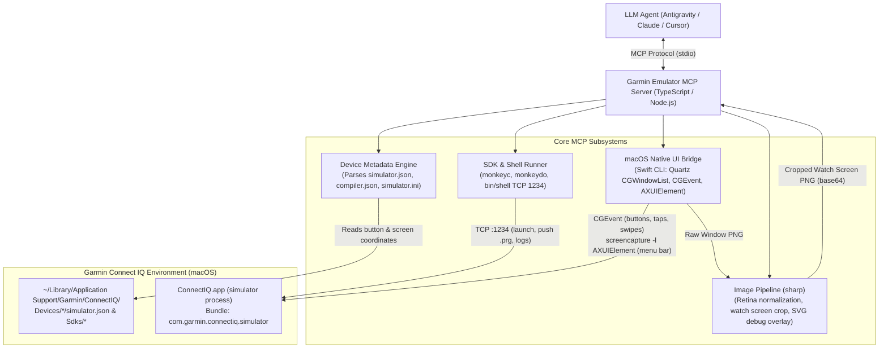

# Garmin Connect IQ Simulator MCP Server

[](https://apple.com)
[](https://developer.garmin.com/connect-iq/)
[](https://modelcontextprotocol.io)
[](https://www.typescriptlang.org)

A Model Context Protocol (MCP) server for automating and inspecting the Garmin Connect IQ Simulator on macOS and Windows.

Windows support uses PowerShell and Windows UI Automation. Screenshot capture uses `PrintWindow`; a minimized simulator may not render correctly. Windows OCR requires an installed OCR language pack and does not return confidence scores. Windows UI Automation exposes different elements from macOS Accessibility. The window must be in the interactive desktop for input. Windows key codes are Windows virtual key codes.

Before input, the bridge waits for foreground activation and verifies the simulator still owns focus. If Windows refuses activation or another window takes focus before input begins, the command fails without sending input; bring the simulator's main window to the foreground and retry.

Enables AI coding agents (Antigravity, Claude Code, Cursor) to build, run, test, tap, swipe, press hardware buttons, stream logs, and visually inspect Garmin watchfaces, data fields, and device apps.

---

## Architecture



---

## Available MCP Tools

### 1. Lifecycle & Device Management

| Tool | Parameters | Description |
| :--- | :--- | :--- |
| `simulator_status` | _none_ | Returns running state, window ID, bounds, macOS Screen Recording and Accessibility permissions, TCP port 1234 status, and active device profile metadata. |
| `launch_simulator` | `wait_ms?: number` | Launches `ConnectIQ.app` from the active SDK and waits for TCP port 1234 to be open (default timeout 15000ms). |
| `list_devices` | `query?: string`, `touch_only?: boolean` | Lists all installed Garmin device profiles in `Devices/` with display resolution, touch capability, shape, and buttons. |
| `set_active_device` | `device_id: string` | Sets the active device ID (e.g. `fenix847mm`, `venu3`, `fr965`) for subsequent simulator commands, button presses, and screenshot cropping. |
| `build_app` | `project_dir: string`, `device_id?: string`, `jungle_file?: string`, `developer_key_path?: string`, `output_prg_path?: string`, `extra_args?: string[]` | Compiles a Monkey C project for a specified device using the SDK `monkeyc` compiler. |
| `run_app` | `prg_path: string`, `device_id?: string`, `wait_ms?: number`, `capture_after?: boolean` | Pushes and executes a compiled `.prg` binary on the active device using `monkeydo`, streaming logs and optionally returning an initial screenshot. |
| `stop_app` | _none_ | Terminates the active app child process in the simulator. |
| `run_unit_tests` | `prg_path: string`, `device_id?: string`, `test_name?: string`, `timeout_ms?: number` | Runs unit tests on a compiled test `.prg` using `monkeydo -t`. |

### 2. Navigation & User Input Synthesis

| Tool | Parameters | Description |
| :--- | :--- | :--- |
| `press_button` | `button: string`, `hold?: boolean`, `hold_ms?: number`, `device_id?: string`, `method?: "mouse" \| "key"`, `capture_after?: boolean`, `wait_ms?: number` | Presses a physical bezel button (`select`, `back`, `up`, `down`, `menu`). Supports short click or long-press hold, returning the updated watch screen. |
| `press_button_sequence` | `steps: Array<{ button, hold?, hold_ms?, wait_ms? }>`, `device_id?: string`, `capture_after?: boolean` | Executes a sequence of button presses in order with delays between steps, returning the final watch screen. |
| `send_key` | `key?: string`, `key_code?: number`, `hold_ms?: number`, `capture_after?: boolean`, `wait_ms?: number`, `device_id?: string` | Sends a macOS virtual key code or named key (`enter`, `esc`, `up`, `down`, `menu`, `space`) to the simulator window. |
| `tap_screen` | `x: number`, `y: number`, `normalized?: boolean`, `device_id?: string`, `capture_after?: boolean`, `wait_ms?: number` | Clicks the watch touchscreen at display coordinates $(X, Y)$ or normalized $(0.0..1.0)$, returning the updated screen. |
| `swipe_screen` | `direction: "up" \| "down" \| "left" \| "right"`, `device_id?: string`, `capture_after?: boolean`, `wait_ms?: number` | Synthesizes a touch drag adhering to device gesture thresholds (e.g. right swipe triggers `onBack`), returning the updated screen. |
| `hold_screen` | `x: number`, `y: number`, `duration_ms?: number`, `normalized?: boolean`, `device_id?: string`, `capture_after?: boolean`, `wait_ms?: number` | Long-presses at specific watch display coordinates (default 1000ms), returning the updated screen. |

### 3. Visual Inspection & Logs

| Tool | Parameters | Description |
| :--- | :--- | :--- |
| `get_screenshot` | `view?: "screen" \| "bezel" \| "annotated"`, `device_id?: string`, `save_path?: string` | Captures the simulator window. `"screen"` crops to watch display (1:1 pixel mapping); `"bezel"` captures the watch frame; `"annotated"` draws button hitboxes and a coordinate grid. |
| `get_app_logs` | `lines?: number`, `clear?: boolean` | Retrieves console output, `System.println()` logs, and crash stack traces from the running app. |

### 4. Environment & Menus

| Tool | Parameters | Description |
| :--- | :--- | :--- |
| `trigger_menu_action` | `menu_path: string[]`, `capture_after?: boolean`, `wait_ms?: number` | Triggers a macOS menu item in `ConnectIQ.app` via Accessibility (e.g. `["Simulation", "Activity Data"]`). |
| `set_glance_mode` | `enabled?: boolean`, `capture_after?: boolean`, `wait_ms?: number` | Toggles or sets Glance View mode (`Settings > Glance View`) for testing widget glances. |

---

## Coordinate Calibration & Retina Scaling

1. **Watch Screen Crop (`view: "screen"`)**:
   Garmin devices have exact display bounding boxes specified in `Devices/<device_id>/simulator.json` (e.g. `454x454` at offset `(134, 221)` for `fenix847mm`).
   On macOS Retina displays ($2\times$ pixel density), the server scales the crop window dynamically and normalizes the output image back to $1\times$ logical device pixels (`454x454`), saving up to 75% of vision tokens while matching code drawing coordinates 1:1.

2. **macOS Title & Status Bar Calibration**:
   In `ConnectIQ.app` (`wxWidgets` on macOS), the window features a `28px` macOS title bar at the top and a `28px` status bar at the bottom. The client canvas origin is computed as:
   $$\text{originX} = \max\left(0, \left\lfloor \frac{\text{windowWidth} - \text{bezelWidth}}{2} \right\rfloor\right), \quad \text{originY} = 28$$
   This ensures mouse clicks and drag gestures align with sub-pixel accuracy to hardware bezel buttons and touchscreen boundaries.

---

## Required macOS Permissions

The terminal or IDE hosting the MCP server requires two standard macOS permissions:

1. **Screen Recording**:
   - Required by `/usr/sbin/screencapture` to capture simulator window buffers.
   - Prompted automatically on first screenshot or grant via:
     `System Settings > Privacy & Security > Screen & System Audio Recording`
2. **Accessibility**:
   - Required by `CGEvent` to synthesize mouse clicks, drags, and keystrokes, and by `AXUIElement` to trigger menu items.
   - Grant via:
     `System Settings > Privacy & Security > Accessibility`

Run `simulator_status` at any time to verify permission status.

---

## Installation & Setup

### 1. Build from Source

Install Node.js $\ge 18$, Java, and the Garmin Connect IQ SDK. On macOS, also install Xcode Command Line Tools (`swiftc`). On Windows, Windows PowerShell 5.1 is required.

```bash
git clone https://github.com/keponer/garmin-simulator-mcp.git
cd garmin-simulator-mcp
npm install
npm run build
```

This compiles:
- `bin/macos-bridge` on macOS (native Swift CLI helper)
- `dist/index.js` (TypeScript MCP server)

On Windows, the SDK is discovered in `%APPDATA%\Garmin\ConnectIQ` by default. Set `GARMIN_CONNECTIQ_ROOT` to override the SDK Manager data directory. Keep `src/native/windows-bridge.ps1` alongside the built server.

Run all tests:
```bash
npm test
```

---

## Client Configuration

### Claude Desktop (`claude_desktop_config.json`)

Add to `~/Library/Application Support/Claude/claude_desktop_config.json`:

```json
{
  "mcpServers": {
    "garmin-emulator": {
      "command": "node",
      "args": [
        "/path/to/garmin-emulator-mcp/dist/index.js"
      ]
    }
  }
}
```

### Cursor (`.cursor/mcp.json`)

Add to `.cursor/mcp.json` or `~/.cursor/mcp.json`:

```json
{
  "mcpServers": {
    "garmin-emulator": {
      "command": "node",
      "args": [
        "/path/to/garmin-emulator-mcp/dist/index.js"
      ]
    }
  }
}
```

### Antigravity (`~/.gemini/config/mcp_config.json`)

Add to `~/.gemini/config/mcp_config.json`:

```json
{
  "mcpServers": {
    "garmin-emulator": {
      "command": "node",
      "args": [
        "/path/to/garmin-emulator-mcp/dist/index.js"
      ]
    }
  }
}
```

### OpenCode (`~/.config/opencode/opencode.jsonc`)

Add via the OpenCode CLI:

```bash
opencode mcp add --global garmin-emulator -- node /path/to/garmin-emulator-mcp/dist/index.js
```

Or manually configure under `mcp.servers` in `~/.config/opencode/opencode.jsonc`:

```json
{
  "mcp": {
    "servers": {
      "garmin-emulator": {
        "type": "local",
        "command": [
          "node",
          "/path/to/garmin-emulator-mcp/dist/index.js"
        ]
      }
    }
  }
}
```

---

## License

MIT
