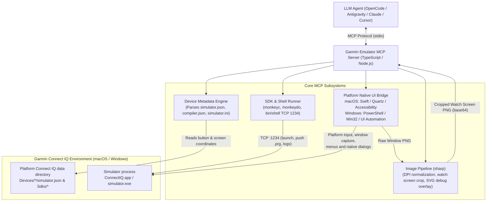

# Garmin Connect IQ Simulator MCP Server

[](https://apple.com)
[](https://www.microsoft.com/windows)
[](https://developer.garmin.com/connect-iq/)
[](https://modelcontextprotocol.io)
[](https://www.typescriptlang.org)

A Model Context Protocol (MCP) server providing metadata-driven automation, input synthesis, and visual inspection for the Garmin Connect IQ Simulator on macOS and Windows.

Enables AI coding agents (OpenCode, Antigravity, Claude Code, Cursor) to build, run, test, tap, swipe, press hardware buttons, read logs, and visually inspect Garmin watchfaces, data fields, and device apps. It also supports native dialog inspection, on-device OCR, and app-scoped file snapshots.

UI automation depends on platform permissions, window focus, simulator state, and device metadata; it is not a guarantee of deterministic app behavior or background-task isolation.

## Platform Support

- **macOS:** supported on `main`, using a Swift native bridge, macOS Accessibility, and `screencapture` with `ConnectIQ.app`.
- **Windows:** supported on `main`, using PowerShell, Windows UI Automation, and `PrintWindow` with `simulator.exe`. See [Windows Requirements & Limitations](#windows-requirements--limitations) for platform-specific behavior.

---

## Architecture



---

## Available MCP Tools

The server exposes 25 tools over stdio. Optional parameters are marked with `?`.

### 1. Lifecycle & Device Management

| Tool | Parameters | Description |
| :--- | :--- | :--- |
| `simulator_status` | _none_ | Returns running state, window ID, bounds, permission fields, TCP port 1234 status, and active device profile metadata. Screen Recording and Accessibility permissions are macOS-specific; Windows reports those fields as `true`. |
| `launch_simulator` | `wait_ms?: number` | Launches the simulator from the active SDK (`ConnectIQ.app` on macOS, `simulator.exe` on Windows) and waits for TCP port 1234 to be open (default timeout 15000ms). |
| `list_devices` | `query?: string`, `touch_only?: boolean` | Lists all installed Garmin device profiles in `Devices/` with display resolution, touch capability, shape, and buttons. |
| `set_active_device` | `device_id: string` | Sets the active device ID (e.g. `fenix847mm`, `venu3`, `fr965`) for subsequent simulator commands, button presses, and screenshot cropping. |
| `build_app` | `project_dir: string`, `device_id?: string`, `jungle_file?: string`, `developer_key_path?: string`, `output_prg_path?: string`, `extra_args?: string[]` | Compiles a Monkey C project for a specified device using the SDK `monkeyc` compiler. |
| `run_app` | `prg_path: string`, `device_id?: string`, `wait_ms?: number`, `capture_after?: boolean` | Pushes and executes a compiled `.prg` binary on the active device using `monkeydo`, streaming logs and optionally returning an initial screenshot. |
| `stop_app` | _none_ | Stops the server-managed `monkeydo`/shell child process. Does not verify that simulator app or background execution has stopped. |
| `run_unit_tests` | `prg_path: string`, `device_id?: string`, `test_name?: string`, `timeout_ms?: number` | Runs a compiled test `.prg` using `monkeydo -t` and returns raw output, parsed summary, exit status, signal, and timeout state (default timeout 30000ms). |
| `terminate_simulator` | `force?: boolean` | Terminates the simulator without deleting stored data. Defaults to graceful termination; reserve `force: true` for an unresponsive simulator. |

### 2. Navigation & User Input Synthesis

| Tool | Parameters | Description |
| :--- | :--- | :--- |
| `press_button` | `button: string`, `hold?: boolean`, `hold_ms?: number`, `device_id?: string`, `method?: "mouse" \| "key"`, `capture_after?: boolean`, `wait_ms?: number` | Presses a physical bezel button (`select`, `back`, `up`, `down`, `menu`). Supports short click or long-press hold, returning the updated watch screen. |
| `press_button_sequence` | `steps: Array<{ button, hold?, hold_ms?, wait_ms? }>`, `device_id?: string`, `capture_after?: boolean` | Executes a sequence of button presses in order with delays between steps, returning the final watch screen. |
| `send_key` | `key?: string`, `key_code?: number`, `hold_ms?: number`, `capture_after?: boolean`, `wait_ms?: number`, `device_id?: string` | Sends a named key (`enter`, `esc`, `up`, `down`, `menu`, `space`) or platform-specific virtual key code to the simulator. Numeric codes differ between macOS and Windows; prefer named keys for portability. |
| `tap_screen` | `x: number`, `y: number`, `normalized?: boolean`, `device_id?: string`, `capture_after?: boolean`, `wait_ms?: number` | Clicks the watch touchscreen at display coordinates $(X, Y)$ or normalized $(0.0..1.0)$, returning the updated screen. |
| `swipe_screen` | `direction: "up" \| "down" \| "left" \| "right"`, `device_id?: string`, `capture_after?: boolean`, `wait_ms?: number` | Synthesizes a touch drag adhering to device gesture thresholds (e.g. right swipe triggers `onBack`), returning the updated screen. |
| `hold_screen` | `x: number`, `y: number`, `duration_ms?: number`, `normalized?: boolean`, `device_id?: string`, `capture_after?: boolean`, `wait_ms?: number` | Long-presses at specific watch display coordinates (default 1000ms), returning the updated screen. |

### 3. Visual Inspection & Logs

| Tool | Parameters | Description |
| :--- | :--- | :--- |
| `get_screenshot` | `view?: "screen" \| "bezel" \| "annotated"`, `device_id?: string`, `save_path?: string` | Captures the simulator window. `"screen"` crops to watch display (1:1 pixel mapping); `"bezel"` captures the watch frame; `"annotated"` draws button hitboxes and a coordinate grid. |
| `get_app_logs` | `lines?: number`, `clear?: boolean` | Retrieves console output, `System.println()` logs, and crash stack traces from the running app. |
| `recognize_image_text` | `image_path: string` | Recognizes text in a saved simulator PNG using local macOS Vision or Windows OCR, returning text and normalized bounds. Confidence scores are available only on macOS; Windows requires an installed OCR language pack. |

### 4. Environment & Menus

| Tool | Parameters | Description |
| :--- | :--- | :--- |
| `trigger_menu_action` | `menu_path: string[]`, `capture_after?: boolean`, `wait_ms?: number` | Triggers a simulator menu item using the platform's native bridge (e.g. `["Simulation", "Activity Data"]`). |
| `set_glance_mode` | `enabled?: boolean`, `capture_after?: boolean`, `wait_ms?: number` | Selects `Settings > Glance Launch Mode > Launch in Glance Mode` or `Launch in Normal Mode`. Omit `enabled` to toggle based on `simulator.ini`. |
| `inspect_ui` | `depth?: number` | Reads the simulator's native Accessibility/UI Automation hierarchy, including menus and dialogs (depth 1–14, default 7). Available elements differ by platform; the watch app's drawn UI is not exposed as native controls. |
| `act_on_ui` | `path: number[]`, `action: "set" \| "select" \| "focus" \| "AXPress" \| "AXConfirm" \| "AXIncrement" \| "AXDecrement"`, `value?: string` | Acts on a freshly inspected native element. Paths are ephemeral: call `inspect_ui` before acting. |
| `close_storage_editor` | _none_ | Closes the persistent-storage editor and verifies its window is gone; safe when already closed. |

### 5. App File Snapshots

| Tool | Parameters | Description |
| :--- | :--- | :--- |
| `snapshot_app_files` | `directory: string`, `app_names: string[]` | Creates an app-scoped backup and checksum manifest in a new directory outside simulator storage. Use an idle/stopped session with no background writes; this tool does not stop the app. |
| `restore_app_files` | `directory: string`, `app_names: string[]`, `confirm_stopped: true` | Validates a matching snapshot, restores its files, and removes matching app files created since the snapshot. Requires a stopped session with no background writes. |

## Execution & Storage Safety

- **Device selection:** `set_active_device` selects the server's metadata profile; it does not switch the running simulator device. Use a matching `device_id` when building and running the app to avoid incorrect input coordinates or screenshot crops.
- **Startup evidence:** `run_app` can return `launched: true` when its launcher remains alive past `wait_ms` without fatal output, while `startupConfirmed` remains `false`. A recognized startup marker sets `startupConfirmed: true`; inspect screenshots and logs to verify app behavior.
- **Stopping:** `stop_app` only stops the managed launcher. Do not treat its result as proof that all app/background writes have stopped. To shut down the simulator, use `terminate_simulator`, verify stopped status with `simulator_status`, and relaunch separately when needed.
- **Test results:** `run_unit_tests` requires a complete, consistent, nonempty passing results table, no fatal runner output, and no signal or timeout. The current runner accepts exit code 0 or the SDK 9.3.0 exit-code-1 quirk; the latter is reported with `exitCodeWarning`. Unrecognized or incomplete output is not a pass.
- **Snapshot scope:** provide 1–8 uppercase PRG basenames without extensions or path separators (for example, `["MYAPP"]`). Names may contain letters, digits, `_`, and `-`, up to 64 characters; simulator container names such as `DATA` and `SETTINGS` are rejected. Snapshots cover only matching files under `GARMIN/APPS`: `DATA/<APP>.{DAT,IDX,IMT}`, `SETTINGS/<APP>.SET`, `MEDIA/<APP>.PRG`, and `DATA/{MEDIA/OBJSTORE,OBJSTORE}/<APP>/`.
- **Restore is destructive within that scope:** it overwrites matching files and deletes matching files absent from the snapshot. Use the same app names and storage root as the snapshot, and confirm no foreground or background writes are active before passing `confirm_stopped: true`; the flag is caller confirmation, not an automatic idle check. Snapshots do not include `GARMIN/sys.nfm`, so file-level restore is not a complete simulator reset.
- **OCR is supporting evidence:** recognized text does not replace storage assertions or functional tests.

---

## Coordinate Calibration & Display Scaling

1. **Watch Screen Crop (`view: "screen"`)**:
   Garmin devices have exact display bounding boxes specified in `Devices/<device_id>/simulator.json` (e.g. `454x454` at offset `(134, 221)` for `fenix847mm`).
   On macOS Retina displays ($2\times$ pixel density), the server scales the crop window dynamically and normalizes the output image back to $1\times$ logical device pixels (`454x454`). This reduces image pixel count by 75% compared with the same region at $2\times$ while matching code drawing coordinates 1:1; model token usage varies.

2. **macOS Title & Status Bar Calibration**:
   The calibration assumes a `28px` title bar when the window has sufficient height. With valid bezel dimensions, the client canvas origin is computed as:

   ```text
   originX = max(0, round((windowWidth - bezelWidth) / 2))
   originY = 28 if windowHeight >= bezelHeight + 28
             otherwise max(0, windowHeight - bezelHeight)
   ```

   An explicit fallback offset overrides `originY`; without valid bezel dimensions, the helper returns that offset or `(0, 28)`. Input coordinates are rounded to logical screen pixels. Use `get_screenshot` with `view: "annotated"` to inspect alignment if the simulator layout or device profile differs.

3. **Windows DPI Calibration**:
   The Windows bridge reports the native client-area offset and monitor DPI scale. Input coordinates combine that offset with scaled device coordinates; screenshot processing uses the client-area offset and normalizes the bezel and watch display back to device pixels. It does not use the macOS `28px` title-bar assumption.

---

## Required macOS Permissions

The terminal or IDE hosting the MCP server requires two standard macOS permissions:

1. **Screen Recording**:
   - Required by `/usr/sbin/screencapture` to capture simulator window buffers.
   - Prompted automatically on first screenshot or grant via:
     `System Settings > Privacy & Security > Screen & System Audio Recording`
2. **Accessibility**:
   - Required by `CGEvent` to synthesize mouse clicks, drags, and keystrokes, and by `AXUIElement` to trigger menu items.
   - Grant via:
     `System Settings > Privacy & Security > Accessibility`

Run `simulator_status` at any time to verify permission status.

## Windows Requirements & Limitations

- Windows PowerShell 5.1 and an interactive desktop session are required. Keep the simulator's main window visible; `PrintWindow` capture may not render correctly when minimized.
- Before input, the bridge waits for foreground activation and verifies the simulator still owns focus. If Windows refuses activation or another window takes focus before input begins, the command fails without sending input. Bring the simulator's main window to the foreground and retry.
- Windows UI Automation exposes different elements from macOS Accessibility. Inspect native controls afresh with `inspect_ui` instead of reusing paths from another platform or session.
- Numeric `key_code` values are Windows virtual key codes, not macOS key codes.
- OCR requires an installed OCR language pack and returns no confidence scores.

---

## Installation & Setup

### 1. Prerequisites

- Node.js 18 or later and Java for the Garmin compiler. Prefer a currently supported Node.js LTS release.
- **macOS:** macOS 13 or later, Xcode Command Line Tools (`swiftc`), and the Screen Recording and Accessibility permissions described above.
- **Windows:** Windows PowerShell 5.1 and an interactive desktop session, as described above. No Swift compiler is needed.
- [Garmin Connect IQ SDK Manager](https://developer.garmin.com/connect-iq/sdk/), an installed SDK, and downloaded profiles for the devices you want to use. The server expects `bin/ConnectIQ.app`, `monkeyc`, `monkeydo`, and `shell` on macOS, or `bin/simulator.exe`, `monkeyc.bat`, `monkeydo.bat`, and `shell.exe` on Windows.
- A developer signing key for `build_app`. Pass `developer_key_path` explicitly, or let the server search project key files, SDK Manager configuration, the Connect IQ root, and home-directory defaults such as `~/.garmin/developer_key.der`.

The Connect IQ root defaults to:

| Platform | Connect IQ root |
| :--- | :--- |
| macOS | `~/Library/Application Support/Garmin/ConnectIQ` |
| Windows | `%APPDATA%\Garmin\ConnectIQ` |

SDK discovery reads `current-sdk.cfg`, falling back to the first SDK directory in descending name order under `Sdks/`. Device profiles are read from `Devices/`.

For a nonstandard installation, set `GARMIN_CONNECTIQ_ROOT` in the MCP server process environment to the Connect IQ root containing `Devices/` and `current-sdk.cfg` or `Sdks/` (not directly to an SDK's `bin/` directory).

### 2. Build from Source

```bash
git clone https://github.com/keponer/garmin-simulator-mcp.git
cd garmin-simulator-mcp
npm install
npm run build
```

This compiles:
- `bin/macos-bridge` on macOS (native Swift CLI helper)
- `dist/index.js` (TypeScript MCP server)

On Windows, `npm run build` skips Swift compilation. Keep `src/native/windows-bridge.ps1` in the repository layout alongside `dist/`; the built server loads that script at runtime.

### 3. Verify Setup

After configuring your MCP client below, call `simulator_status` to check permissions, then `list_devices` to confirm the target profile is installed. Call `launch_simulator`, build with `build_app`, and run the returned `.prg` with `run_app`, using the same `device_id` throughout. Inspect the screenshot and `get_app_logs` rather than relying on launcher status alone.

## Development & Testing

Run the regression suites (metadata, bridge/image, tools, process manager, result parser, unit runner, and testing tools):

```bash
npm test
```

These are not app functional or cross-device tests. Image tests use synthetic images; some suites inspect the installed SDK or window status. On Windows, `npm test` also includes the `windows-native` suite.

Type-check the test suite separately:

```bash
npm run typecheck:test
```

Run live client verification only in an isolated simulator session; it can press a button on the active app:

```bash
npm run test:e2e
```

Live captures may be conditionally skipped when permissions are unavailable; a skip is not a successful capture. See [TESTING.md](TESTING.md) for testing details and limitations.

Use `npm run build:ts` after TypeScript-only changes or `npm run build` when the native helper also changes. Reconnect/restart the MCP server connection so clients load rebuilt server code.

---

## Client Configuration

Use the absolute path to your checkout's `dist/index.js`. On Windows, use a JSON path such as `C:/Code/garmin-simulator-mcp/dist/index.js` (or escape backslashes as `\\`). The server command remains `node` on both platforms.

### Claude Desktop (`claude_desktop_config.json`)

Add to `~/Library/Application Support/Claude/claude_desktop_config.json` on macOS or `%APPDATA%\Claude\claude_desktop_config.json` on Windows:

```json
{
  "mcpServers": {
    "garmin-emulator": {
      "command": "node",
      "args": [
        "/path/to/garmin-emulator-mcp/dist/index.js"
      ]
    }
  }
}
```

### Cursor (`.cursor/mcp.json`)

Add to `.cursor/mcp.json` or `~/.cursor/mcp.json`:

```json
{
  "mcpServers": {
    "garmin-emulator": {
      "command": "node",
      "args": [
        "/path/to/garmin-emulator-mcp/dist/index.js"
      ]
    }
  }
}
```

### Antigravity (`~/.gemini/config/mcp_config.json`)

Add to `~/.gemini/config/mcp_config.json`:

```json
{
  "mcpServers": {
    "garmin-emulator": {
      "command": "node",
      "args": [
        "/path/to/garmin-emulator-mcp/dist/index.js"
      ]
    }
  }
}
```

### OpenCode (`~/.config/opencode/opencode.jsonc`)

For OpenCode V2, add via the CLI:

```bash
opencode mcp add garmin-emulator --global -- node /path/to/garmin-emulator-mcp/dist/index.js
```

Or manually configure under `mcp.servers` in `~/.config/opencode/opencode.jsonc`:

```json
{
  "$schema": "https://opencode.ai/config.json",
  "mcp": {
    "servers": {
      "garmin-emulator": {
        "type": "local",
        "command": [
          "node",
          "/path/to/garmin-emulator-mcp/dist/index.js"
        ]
      }
    }
  }
}
```

---

## License

MIT
